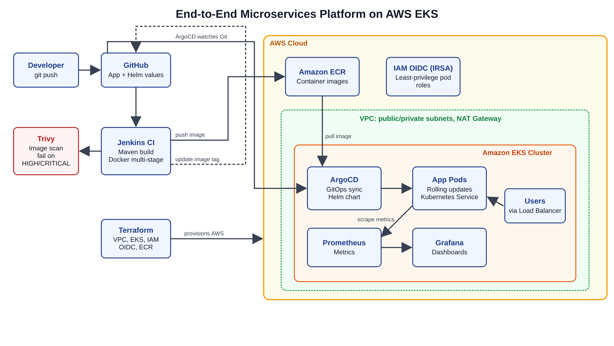

# End-to-End Microservices Platform on AWS EKS

AWS platform built entirely as code: Terraform provisions the network and EKS cluster, Jenkins builds, tests and scans a containerized Java (Spring Boot) app, and ArgoCD deploys it to EKS with Helm (GitOps). Prometheus and Grafana provide monitoring.



## Tech Stack
| Area | Tools |
|---|---|
| Cloud | AWS (VPC, EKS, ECR, IAM OIDC/IRSA, S3) |
| IaC | Terraform (terraform-aws-modules: VPC, EKS, IAM) |
| CI | Jenkins, Maven, Docker (multi-stage, non-root), Trivy |
| CD | Helm, ArgoCD (GitOps), HPA, rolling updates |
| Monitoring | Prometheus, Grafana (kube-prometheus-stack) |

## Architecture Flow
1. **Terraform** creates the VPC (2 AZs, public/private subnets, NAT Gateway), EKS cluster with a managed node group in private subnets, an ECR repo, an S3 bucket and an IRSA role.
2. A developer pushes code; **Jenkins** builds and unit-tests the Java app with Maven.
3. Jenkins builds a multi-stage **Docker** image (slim JRE, non-root user) and scans it with **Trivy**. HIGH/CRITICAL findings fail the build.
4. The image is pushed to **Amazon ECR**, and Jenkins commits the new image tag to `helm/demo-app/values.yaml`.
5. **ArgoCD** detects the Git change and syncs the **Helm** chart to EKS with zero-downtime rolling updates; **HPA** scales pods on CPU.
6. The app's pod uses **IRSA** (IAM role for its service account) for least-privilege S3 read access, with no static AWS keys.
7. **Prometheus** scrapes cluster metrics and the app's `/actuator/prometheus` endpoint; **Grafana** dashboards show CPU/memory, node health and request latency.

## Repository Structure
```
terraform/        # VPC, EKS, ECR, S3, IRSA (main.tf, variables.tf, outputs.tf)
app/              # Spring Boot app with Actuator + Prometheus metrics
Dockerfile        # Multi-stage build, non-root runtime image
Jenkinsfile       # Build/Test -> Docker -> Trivy -> Push to ECR -> Update Helm tag
helm/demo-app/    # Deployment, Service, HPA, ServiceAccount (IRSA), ServiceMonitor
argocd/           # ArgoCD Application (auto-sync, self-heal, prune)
monitoring/       # kube-prometheus-stack values
docs/             # Architecture diagram and screenshots
```

## Prerequisites
- AWS account and AWS CLI configured (`aws configure`)
- Terraform >= 1.5, kubectl, Helm 3
- Jenkins agent with Docker, Maven, JDK 17, AWS CLI and Trivy, plus an IAM role/credentials allowed to push to ECR
- Jenkins credential `github-token` (username + GitHub personal access token) to push the Helm tag commit

## How to Run
```bash
# 1. Provision infrastructure (about 15 minutes)
cd terraform
terraform init
terraform plan
terraform apply

# 2. Connect kubectl to the cluster
$(terraform output -raw configure_kubectl)
kubectl get nodes

# 3. Put the IRSA role ARN in helm/demo-app/values.yaml (serviceAccount.roleArn)
terraform output app_irsa_role_arn
cd ..

# 4. Install metrics-server (needed by HPA) and monitoring
helm repo add metrics-server https://kubernetes-sigs.github.io/metrics-server/
helm repo add prometheus-community https://prometheus-community.github.io/helm-charts
helm repo update
helm install metrics-server metrics-server/metrics-server -n kube-system
helm install monitoring prometheus-community/kube-prometheus-stack \
  -n monitoring --create-namespace -f monitoring/kube-prometheus-stack-values.yaml

# 5. Install ArgoCD and register the app
kubectl create namespace argocd
kubectl apply -n argocd -f https://raw.githubusercontent.com/argoproj/argo-cd/stable/manifests/install.yaml
kubectl apply -f argocd/application.yaml

# 6. Run the Jenkins pipeline (builds, scans, pushes and updates the Helm tag)
# 7. Check the app
kubectl get pods,svc,hpa -n demo
curl http://$(kubectl get svc demo-app -n demo -o jsonpath='{.status.loadBalancer.ingress[0].hostname}')/
```

**Verify IRSA:** `kubectl exec -n demo deploy/demo-app -- env | grep AWS_ROLE_ARN`

**ArgoCD UI:** `kubectl port-forward svc/argocd-server -n argocd 8081:443`, user `admin`, password from
`kubectl -n argocd get secret argocd-initial-admin-secret -o jsonpath="{.data.password}" | base64 -d`

**Grafana UI:** `kubectl get svc -n monitoring monitoring-grafana`, user `admin`, password from
`kubectl -n monitoring get secret monitoring-grafana -o jsonpath="{.data.admin-password}" | base64 -d`

## Cleanup
Delete LoadBalancer services first so Terraform can remove the VPC:
```bash
kubectl delete -f argocd/application.yaml
helm uninstall monitoring -n monitoring
cd terraform && terraform destroy
```

## Author
**Bonigi Syam Prasad**, DevOps & Cloud Engineer
[LinkedIn](https://www.linkedin.com/in/bonigi)
